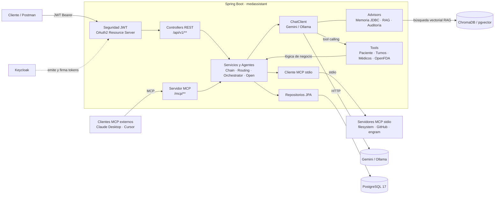
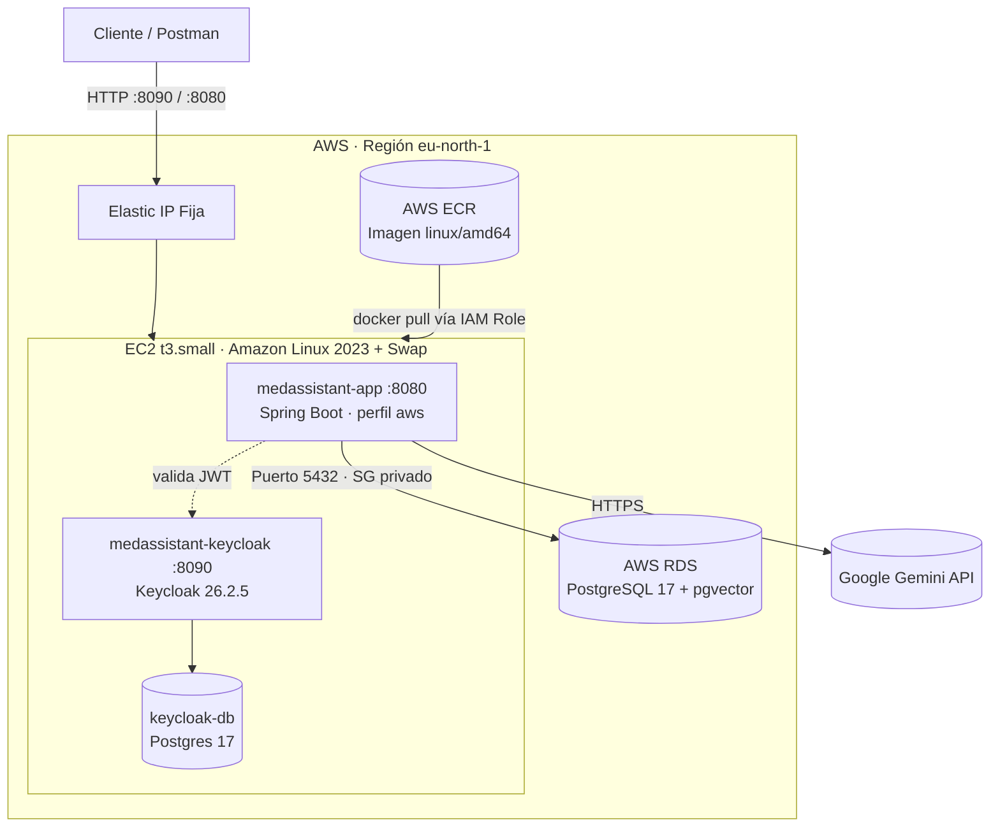

<div align="center">

# 🩺 MedAssistant AI

**Asistente médico conversacional en producción con Spring Boot, Spring AI, RAG, Agentes Autónomos, MCP y AWS**


</div>

> ⚠️ **Aviso:** Proyecto educativo y de portfolio técnico. La información generada por esta aplicación no sustituye en ningún caso el consejo, diagnóstico o tratamiento de un profesional médico.

---

## 📋 Índice

- [🎯 Descripción del proyecto](#-descripción-del-proyecto)
- [✨ Funcionalidades](#-funcionalidades)
- [🛠 Stack tecnológico](#-stack-tecnológico)
- [🏗 Arquitectura](#-arquitectura)
- [🤖 Cómo funcionan los agentes](#-cómo-funcionan-los-agentes)
- [📚 Flujo RAG](#-flujo-rag)
- [☁️ Despliegue en AWS](#️-despliegue-en-aws)
- [📁 Estructura del proyecto](#-estructura-del-proyecto)
- [⚙️ Perfiles y ejecución en local](#️-perfiles-y-ejecución-en-local)
- [🌐 Endpoints de la API](#-endpoints-de-la-api)
- [🧪 Ejemplos con curl](#-ejemplos-con-curl)
- [🧩 Decisiones técnicas](#-decisiones-técnicas)
- [🧠 Lo que aprendí](#-lo-que-aprendí)
- [🔮 Próximos pasos](#-próximos-pasos)
- [👤 Autor](#-autor)

---

## 🎯 Descripción del proyecto

**MedAssistant** es una API REST backend construida con **Java 21**, **Spring Boot** y **Spring AI** que integra capacidades avanzadas de IA generativa en una arquitectura lista para producción:

- **Conversación con memoria persistente** en PostgreSQL y respuestas en tiempo real vía **SSE (Server-Sent Events)**.
- **RAG (Retrieval-Augmented Generation)** sobre documentación clínica en PDF con **ChromaDB** (local) y **pgvector en AWS RDS** (producción).
- **Cuatro patrones de agentes** (*Chain + Human-in-the-Loop*, *Routing*, *Orchestrator-Workers* y *Open Agent*).
- **Soporte MCP (Model Context Protocol)** tanto como **cliente** como **servidor stateless**.
- **Seguridad OAuth2 / JWT con Keycloak** y despliegue contenerizado en **AWS (EC2, ECR y RDS)**.

---

## ✨ Funcionalidades

### 💬 Chat y Memoria
- Memoria conversacional con ventana deslizante (`MessageWindowChatMemory`, máximo 9 mensajes) persistida en base de datos vía JDBC.
- Respuestas síncronas (`POST /api/v1/chat`) y en streaming por SSE (`POST /api/v1/chat/stream`).
- **Advisor de auditoría (`MedicalAuditAdvisor`):** intercepta llamadas síncronas y streaming para registrar conversación, pregunta, latencia y preview de respuesta sin ensuciar controladores ni servicios.

### 📚 RAG e Ingesta Clínica
- Ingesta automática e idempotente de 3 PDFs médicos en `src/main/resources/docs` (farmacología del ibuprofeno, guía de hipertensión y protocolo cardiovascular).
- Recuperación automática mediante `QuestionAnswerAdvisor` (`topK=3`, umbral de similitud `0.7`).
- Ingesta de nuevos PDFs en caliente sin reiniciar (`POST /api/v1/documents/ingest`, restringido a `ADMIN`).

### 🧰 Tool Calling
- `getPatientInfo`: consulta el historial clínico validando mediante `ToolContext` que el `userId` del JWT coincide con el `patientId` solicitado.
- `searchAppointments`: búsqueda de turnos disponibles por especialidad y fecha.
- `bookAppointment`: reserva de citas con doble barrera de seguridad por rol (`ADMIN`).
- `searchDoctors`: búsqueda de médicos por apellido o especialidad.
- `getDrugInfo`: consulta en tiempo real a la API pública **OpenFDA** (con recorte de texto para optimizar la ventana de contexto).

### 🔌 Model Context Protocol (MCP)
- **Servidor MCP (`medassistant-mcp`, `STATELESS`):** expone las tools `search-doctors` y `search-appointments`, el resource `doctor://{specialty}` y el prompt `symptom-consultation` a clientes externos como Claude Desktop o Cursor.
- **Cliente MCP (entorno local):** conexiones `stdio` configuradas (`filesystem`, `GitHub`, `engram`) accesibles vía `POST /api/v1/mcp/demo`.

### 🔐 Seguridad OAuth2 + Keycloak
- API stateless protegida como **OAuth2 Resource Server** con tokens JWT firmados por Keycloak.
- Traducción defensiva de `realm_access.roles` a authorities de Spring (`ROLE_PATIENT`, `ROLE_ADMIN`).
- Todos los endpoints `/api/v1/**` exigen rol `PATIENT` o `ADMIN`; `/mcp/**` permanece público.

---

## 🛠 Stack tecnológico

| Área | Tecnología | Versión / Detalle |
|---|---|---|
| **Lenguaje** | Java | 21 |
| **Framework** | Spring Boot | 4.1.1 |
| **IA Generativa** | Spring AI (BOM) | 2.0.1 (Chat, RAG, Tools, MCP) |
| **LLMs & Embeddings** | Google GenAI / Ollama | `gemini-3.1-flash-lite` + `gemini-embedding-001` · `llama3.2:3b` + `nomic-embed-text` |
| **Seguridad** | Spring Security + Keycloak | OAuth2 Resource Server (JWT) · Keycloak 26.2.5 |
| **Base de datos** | PostgreSQL + Spring Data JPA | PostgreSQL 17 |
| **Vector Store** | ChromaDB / pgvector | ChromaDB (local) · `pgvector` en RDS (AWS) |
| **Procesamiento PDF** | Apache Tika | `spring-ai-tika-document-reader` |
| **Infraestructura** | Docker & AWS | Docker Compose · ECR · EC2 (Amazon Linux 2023) · RDS |
| **Utilidades** | Lombok & Maven Wrapper | Reducción de boilerplate y build reproducible |

---

## 🏗 Arquitectura



La configuración de proveedores se resuelve por perfiles mediante la interfaz `ClientResolver` (implementaciones separadas para local y AWS). Los prompts están externalizados como plantillas **StringTemplate** en `src/main/resources/prompts`, y la misma lógica de negocio se reutiliza tanto para el tool calling interno (`@Tool`) como para el servidor MCP (`@McpTool`, `@McpResource`, `@McpPrompt`).

---

## 🤖 Cómo funcionan los agentes

| Patrón | Implementación | Cómo opera |
|---|---|---|
| **1. Chain + Human-in-the-Loop** | `AppointmentChainServiceImpl` | Pipeline de 3 pasos (`appointment-extraction.st`, `appointment-confirmation.st`): extrae especialidad y fecha, busca huecos reales en BD y guarda la propuesta en `PendingBookingStore` (`ConcurrentHashMap`). Solo persiste tras confirmación explícita revalidando disponibilidad para evitar doble booking. |
| **2. Router Workflow** | `RoutingWorkFlowServiceImpl` | Clasifica la intención (`SYMPTOM_REPORT`, `GENERAL_QUESTION`, `EMERGENCY`, `PRESCRIPTION_REQUEST`, `OFF_TOPIC`) y delega vía `switch` al sub-agente especializado. Las consultas `OFF_TOPIC` devuelven respuesta fija **sin llamar al LLM** (ahorro de tokens). |
| **3. Orchestrator-Workers** | `OrchestratorServiceImpl` | **Fan-out** a 3 especialistas: `ClinicalWorker` (razonamiento clínico con LLM), `HistoryWorker` (consulta a BD sin LLM) y `BibliographyWorker` (búsqueda RAG propia). **Fan-in** con síntesis final (`orchestrator-synthesis.st`). Soporta progreso en vivo por SSE usando `Schedulers.boundedElastic()`. |
| **4. Open Agent** | `OpenAgentServiceImpl` | Agente autónomo con 4 tools (`PatientInfo`, `AppointmentSearch`, `DoctorInfo`, `DrugInfo`). Inyecta la fecha actual en `open-agent.st` para evitar alucinaciones temporales y pasa `userId`/`role` vía `ToolContext` para mitigar *prompt injection*. |

---

## 📚 Flujo RAG

1. **Ingesta idempotente (`@PostConstruct`):** `DocumentIngestionServiceImpl` (local) o `DocumentIngestionServiceAwsImpl` (AWS) leen los PDFs de `classpath:docs` con `TikaDocumentReader` y los dividen con `TokenTextSplitter` (~800 tokens por chunk, máximo 1000 chunks). Antes de ingestar, comprueban si el vector store ya contiene documentos.
2. **Embeddings y almacenamiento:**
    - **Local (ChromaDB):** colecciones separadas `medassistant_google` y `medassistant_ollama` (los espacios vectoriales de distintos modelos no son compatibles entre sí).
    - **AWS (pgvector):** tabla `medassistant_google` con vectores de 3072 dimensiones dentro del mismo PostgreSQL en RDS.
3. **Recuperación:** `QuestionAnswerAdvisor` (`topK=3`, similitud `>= 0.7`) enriquece cada chat automáticamente. Adicionalmente, `BibliographyWorker` ejecuta su propia recuperación (`topK=3`, similitud `>= 0.3`) con respuesta *fail-fast* si no encuentra soporte documental.

---

## ☁️ Despliegue en AWS



- **Imagen multi-stage (`linux/amd64`):** compilada con Maven/JDK 21 y ejecutada en JRE 21 con usuario no-root y `-XX:MaxRAMPercentage=75.0`, publicada en **Amazon ECR**.
- **Autenticación sin secretos estáticos:** la instancia EC2 utiliza un **IAM Role** para hacer `docker pull` desde ECR sin almacenar credenciales AWS en disco.
- **Seguridad de red:** el Security Group de **RDS** solo acepta tráfico en el puerto `5432` procedente del Security Group de la instancia EC2 (sin acceso público).
- **Gestión de configuración:** secretos (`RDS_PASSWORD`, `GOOGLE_AI_API_KEY`, `RDS_HOST`) inyectados exclusivamente mediante archivo `.env` en el servidor, fuera de la imagen y de Git.

---

## 📁 Estructura del proyecto

```text
src/main/java/com/example/medassistant
├── MedassistantApplication.java   # Punto de entrada Spring Boot
├── agent/                         # Patrones de agentes (Chain, Routing, Open Agent)
│   └── orchestrator/              # Orquestador y workers (Clinical, History, Bibliography)
├── config/                        # Seguridad JWT, ChatClients, Memoria JDBC, Auditoría, Seeding
├── controller/                    # Controladores REST (/api/v1/**)
├── dto/                           # Records de entrada/salida (agent, analysis)
├── exception/                     # Manejo global de excepciones
├── mcp/                           # Servidor MCP: resources y prompts expuestos
├── model/                         # Entidades JPA (Patient, Doctor, Appointment)
├── repository/                    # Repositorios Spring Data JPA
├── service/                       # Lógica de negocio y servicios de IA
├── tools/                         # Herramientas (@Tool / @McpTool)
└── util/                          # Utilidades de seguridad (extracción de roles JWT)
```

---

## ⚙️ Perfiles y ejecución en local

### Perfiles disponibles

| Perfil | Descripción |
|---|---|
| `default` | PostgreSQL local, ChromaDB (`:8000`), Keycloak (`:8090`) y conexiones MCP `stdio`. |
| `gemini` | Activa Google GenAI como proveedor de chat y embeddings (requiere `GOOGLE_AI_API_KEY`). |
| `ollama` | Activa Ollama local (`:11434`) con `llama3.2:3b` y `nomic-embed-text`. |
| `aws` | Producción: RDS PostgreSQL + `pgvector` (`schema-aws.sql`), excluye Ollama/Chroma y deshabilita cliente MCP. Solo admite `gemini`. |

### Pasos para arrancar en local

1. **Levanta la infraestructura con Docker:**
   ```bash
   docker compose up -d
   ```
   *(Inicia PostgreSQL app `:5432`, PostgreSQL Keycloak `:5433`, Keycloak `:8090` y ChromaDB `:8000`. Credenciales solo para desarrollo).*

2. **Configura Keycloak:**
   Importa `medassistant-realm.json` en `http://localhost:8090` (*Create realm → Browse*). El archivo incluye los roles `PATIENT` y `ADMIN` sin secretos ni usuarios; regenera el *client secret* de `medassistant-client` y crea tus usuarios de prueba.

3. **Configura tus variables de entorno:**
   ```bash
   export GOOGLE_AI_API_KEY="tu_api_key_de_gemini"
   # Opcional (solo si usas el servidor MCP de GitHub en local)
   export GITHUB_TOKEN="tu_github_token"
   ```

4. **Ejecuta la aplicación:**
   ```bash
   SPRING_PROFILES_ACTIVE=gemini ./mvnw spring-boot:run
   ```
   *(Cambia `gemini` por `ollama` si prefieres ejecutar modelos locales).*

---

## 🌐 Endpoints de la API

El payload estándar es `{ "prompt": "...", "model": "gemini" | "ollama" }`. El `userId` se extrae siempre del JWT, nunca del cuerpo de la petición.

### 💬 Chat y Consultas
| Método | Ruta | Descripción | Acceso |
|---|---|---|---|
| `POST` | `/api/v1/chat` | Chat síncrono con memoria JDBC y RAG | `PATIENT` / `ADMIN` |
| `POST` | `/api/v1/chat/stream` | Chat en streaming vía SSE | `PATIENT` / `ADMIN` |
| `POST` | `/api/v1/chat/explain` | Explicación accesible de una condición médica | `PATIENT` / `ADMIN` |
| `POST` | `/api/v1/chat/symptoms` | Orientación inicial sobre síntomas | `PATIENT` / `ADMIN` |
| `POST` | `/api/v1/chat/diagnose` | Razonamiento clínico (*chain-of-thought*) | `PATIENT` / `ADMIN` |
| `POST` | `/api/v1/chat/consult` | Consulta médica completa | `PATIENT` / `ADMIN` |

### 🔬 Análisis Estructurado y Documentos
| Método | Ruta | Descripción | Acceso |
|---|---|---|---|
| `POST` | `/api/v1/analysis/condition` | Resumen estructurado (`ConditionSummary`) | `PATIENT` / `ADMIN` |
| `POST` | `/api/v1/analysis/conditions` | Lista de condiciones relacionadas | `PATIENT` / `ADMIN` |
| `POST` | `/api/v1/analysis/symptoms` | Análisis estructurado (`SymptomAnalysis`) | `PATIENT` / `ADMIN` |
| `POST` | `/api/v1/analysis/classify` | Clasificación de intención (`QueryClassification`) | `PATIENT` / `ADMIN` |
| `POST` | `/api/v1/documents/ingest` | Ingesta de PDF en caliente (`multipart`) | `ADMIN` |

### 🤖 Agentes y MCP
| Método | Ruta | Descripción | Acceso |
|---|---|---|---|
| `POST` | `/api/v1/agent/chain/appointment` | Propuesta de cita paso a paso (Chain) | `PATIENT` / `ADMIN` |
| `POST` | `/api/v1/agent/chain/appointment/confirm` | Confirma cita pendiente (Human-in-the-Loop) | `PATIENT` / `ADMIN` |
| `POST` | `/api/v1/agent/chain/appointment/cancel` | Cancela cita pendiente | `PATIENT` / `ADMIN` |
| `POST` | `/api/v1/agent/routing` | Router Workflow por intención | `PATIENT` / `ADMIN` |
| `POST` | `/api/v1/agent/orchestrator` | Orchestrator-Workers (clínico + historial + RAG) | `PATIENT` / `ADMIN` |
| `POST` | `/api/v1/agent/orchestrator/progress` | Orchestrator-Workers con progreso en vivo (SSE) | `PATIENT` / `ADMIN` |
| `POST` | `/api/v1/agent/open` | Agente autónomo con tool calling libre | `PATIENT` / `ADMIN` |
| `POST` | `/api/v1/mcp/demo` | Demo con servidores MCP externos (solo local) | `PATIENT` / `ADMIN` |
| `—` | `/mcp/**` | Servidor MCP (tools, resources y prompts) | Público (`permitAll`) |

---

## 🧪 Ejemplos con curl

```bash
export TOKEN="<JWT_EMITIDO_POR_KEYCLOAK>"

# 1. Chat síncrono con memoria y RAG
curl -X POST http://localhost:8080/api/v1/chat \
  -H "Authorization: Bearer $TOKEN" \
  -H "Content-Type: application/json" \
  -d '{"prompt": "¿Qué cuidados debo seguir si tengo hipertensión?", "model": "gemini"}'

# 2. Orchestrator-Workers con progreso en vivo (SSE)
curl -N -X POST http://localhost:8080/api/v1/agent/orchestrator/progress \
  -H "Authorization: Bearer $TOKEN" \
  -H "Content-Type: application/json" \
  -d '{"prompt": "Dolor torácico opresivo y fatiga al esfuerzo", "model": "gemini"}'
```

---

## 🧩 Decisiones técnicas

- **Abstracción por perfiles (`ClientResolver`):** permite cambiar entre local (`gemini`/`ollama` + ChromaDB) y AWS (`gemini` + RDS `pgvector`) sin tocar la lógica de negocio.
- **Mitigación de Prompt Injection:** la identidad (`userId` y `role`) se extrae siempre del JWT (`@AuthenticationPrincipal`) y se inyecta en `ToolContext`, nunca desde el texto del usuario.
- **Aislamiento de estado en `ChatClient`:** cada petición de agente instancia su propio `ChatClient.create(...)` para evitar fugas de estado entre usuarios concurrentes.
- **Prompts desacoplados:** las plantillas StringTemplate (`.st`) permiten iterar y versionar el comportamiento de cada agente sin recompilar código Java.
- **Optimización de latencia y costes:** ventana de memoria acotada a 9 mensajes, respuesta fija en `OFF_TOPIC` sin invocar al LLM y trabajo bloqueante aislado en `Schedulers.boundedElastic()`.

---

## 🧠 Lo que aprendí

- **La identidad viene del token, nunca del prompt:** inyectar `userId` y roles vía `ToolContext` bloquea intentos de suplantación o escalada de privilegios desde lenguaje natural.
- **Seguridad con Keycloak + Spring Security:** escribí un `JwtAuthenticationConverter` personalizado para mapear `realm_access.roles` a `ROLE_<NOMBRE>` y corregí un bug sutil en `@PreAuthorize` (`HasRole` mal escrito) en el endpoint de ingesta.
- **Espacios vectoriales incompatibles:** aprendí por qué Gemini y Ollama necesitan colecciones separadas (`medassistant_google` vs `medassistant_ollama`) al generar embeddings de distintas dimensiones.
- **ChromaDB en local vs pgvector en AWS:** consolidar datos relacionales y vectores en un único PostgreSQL en RDS reduce complejidad operativa y costes en la nube.
- **Higiene de secretos en Git:** al exportar un realm de Keycloak comprobé que incluye secretos y hashes; aprendí a usar *Partial export* y a rotar credenciales en lugar de limitarme a borrar el archivo del commit.

---

## 🔮 Próximos pasos

- [ ] Automatizar la importación del realm de Keycloak en el `docker-compose.yml` de desarrollo.
- [ ] Proteger `/mcp/**` con autenticación JWT.
- [ ] Añadir suite de tests unitarios y de seguridad (JUnit 5, Mockito, Spring Security Test).
- [ ] Configurar pipeline de CI/CD con GitHub Actions para build y push automático a ECR.
- [ ] Añadir dominio propio y HTTPS mediante Nginx o Application Load Balancer (ACM) para eliminar `sslRequired=NONE`.

---

## 👤 Autor

**Enger Durán** · Java Backend Developer (Spring Boot · Spring AI · AWS)